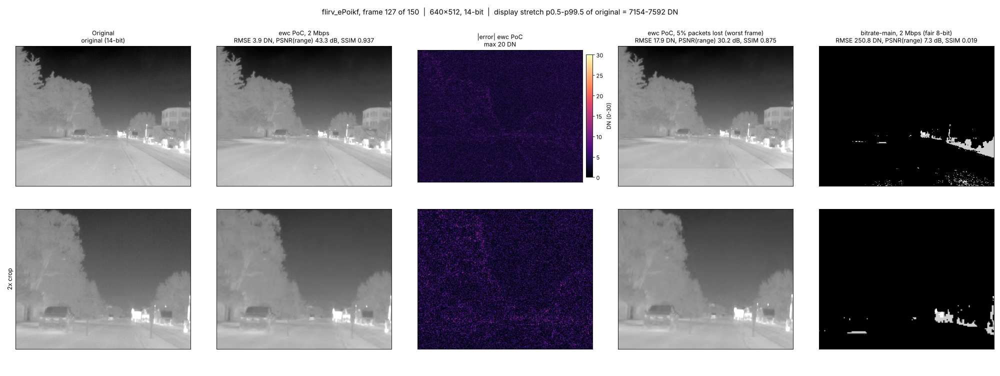

# ewc — Proof-of-Concept Report (RCI Scope of Work)

**Project:** Low-Bitrate, High-Resolution Image/Video Compression with Low Latency
**Phase:** Proof-of-Concept · **Date:** 2026-11-05 · **Code:** this repository

This report answers the Scope of Work (SoW) proof-of-concept section by section. Every number
was measured on the stated data with the code in this repository. Nothing is estimated.

---

## 1. What the PoC must do (from the SoW)

| SoW item | Requirement |
|---|---|
| Input | Infrared images, 640×512, 14-bit monochrome, image sequences in raw binary on disk |
| Bitrate | Fixed 2 Mbps |
| Encoder | Image/frame-level encoding, metadata insertion, bitstream stored to disk, low latency |
| Decoder | Parse bitstream and metadata, write raw 14-bit (2 bytes/pixel, row-major), validate data |
| Latency | Encoder ≤ 2 frames, from input-frame availability to encoded output; method documented |
| Evaluation | Reconstruction quality and error (quantitative and visual), robustness to channel errors (by introducing losses in the stored bitstream), encoder latency, decoder latency |
| Implementation | Self-contained, no external libraries |

Earlier work had aimed elsewhere: the original `bitrate-main` targeted lossless coding of 8-bit
frames (≤ 12 Mbps), and the first ewc evaluation was application-neutral. Lossless is still
available in ewc, but the PoC is judged at 2 Mbps on 14-bit infrared, with losses in the stored
bitstream. This report follows that.

---

## 2. The PoC profile

One preset, `--poc` (library: `ewc::poc_config()`):

| Setting | Value | Why |
|---|---|---|
| Size, bit depth | 640×512, 14-bit | SoW |
| Rate | 2 Mbps, strict CBR: no frame above 8,333 bytes at 30 fps | SoW "fixed bitrate"; frame rate not stated in the SoW, 30 fps assumed (`--fps` changes it) |
| Coding | Intra-only (every frame independent), CDF 9/7 wavelet, embedded SPIHT + arithmetic coding | SoW "frame-level"; best under stored-bitstream losses (section 5.3) |
| Error protection | CRC-32 frame header, CRC-16 per 256 payload bytes, 8 independent groups per frame, 64 redundant bytes per group | Chosen by measurement (section 5.3) |
| Metadata | Header (size, bit depth, sequence, timestamp, profile, parameters) + optional application metadata per frame (`--meta`, up to 65,535 bytes) | SoW "metadata insertion" |
| Threads | 2 | Encoder and decoder output identical for any thread count |

Commands (all in `build/` after `cmake --build`):

```bash
ewc_enc -i in.u16 -o stream.ewc --poc [--fps 30] [--meta "text"]       # encode, store to disk
ewc_dec -i stream.ewc -o out.u16 [--ref in.u16] [--report frames.csv] # decode to raw 14-bit, validate
ewc_corrupt stream.ewc damaged.ewc pktzero 0.05 [seed]               # introduce losses
./run_poc.sh in.u16 [fps] [build] [out_dir]                          # all of the above, end to end
```

---

## 3. Test data

FLIR ADAS v2, the 16-bit TIFFs in `analyticsData` (no rescaling): 150 consecutive frames from each
of the 6 test videos that hold 14-bit data, plus 100 random validation stills; 1,000 frames in all.
Values 3,112–11,947 DN, low contrast (within-frame spread 53–262 DN), sensor noise ≈ 4 DN.
Two of the 8 test videos are 8-bit only and were excluded. Profile choices were tuned on two
clips (4FRnNp, ePoikf) and checked on held-out clips before use. Details:
`eval/results/flir_audit.txt`, `flir_adas_v2_manifest.json`.

---

## 4. Encoder and decoder (SoW 3.1, 3.2)

| SoW requirement | Result |
|---|---|
| Accept 640×512 infrared, 14-bit | Yes. Raw `uint16` in, any value 0–16,383; out-of-range input is refused, never clipped silently |
| Fixed bitrate 2 Mbps | 1,999.5–1,999.8 kbps on every clip; largest frame 8,333 bytes (= budget) |
| Frame-level encoding | Yes; each frame is a self-contained unit |
| Metadata insertion | Yes (section 2) |
| Bitstream storage to disk | Yes (`.ewc` file); format in `docs/FORMAT.md` |
| Decoder parses bitstream and metadata | Yes |
| Decoder writes raw 14-bit, 2 bytes/pixel, row-major | Yes; lossless mode reproduces the input file byte for byte (1,000 FLIR frames) |
| Decoder validates received data | Yes: CRCs on header, metadata and every 256 payload bytes; per-frame report `reliable / damaged / lost` (`ewc_dec --report`); lost frames are replaced by the last frame so the output always has one frame per input frame |
| Self-contained, no external libraries | Yes: C++17 standard library only (links libstdc++, libm, libc) |

---

## 5. Performance evaluation (SoW 4)

### 5.1 Reconstructed image quality and reconstruction error at 2 Mbps

`eval/results/poc_final_clean.jsonl`. PSNR (range) uses the scene's own range (p0.1–p99.9),
the honest measure for low-contrast thermal data; PSNR (14-bit) uses peak 16,383. SSIM is computed
on the display-stretched image.

| Clip | PSNR range dB | PSNR 14-bit dB | SSIM | RMSE DN | Max error DN |
|---|---|---|---|---|---|
| flirv_4FRnNp | 40.14 | 71.44 | 0.910 | 4.39 | 28 |
| flirv_5RSrbW | 34.86 | 72.77 | 0.772 | 3.77 | 23 |
| flirv_6tLtjd | 41.49 | 72.49 | 0.918 | 3.89 | 39 |
| flirv_SCiKdG | 41.09 | 70.65 | 0.809 | 4.81 | 44 |
| flirv_ePoikf | 42.05 | 72.35 | 0.925 | 3.95 | 34 |
| flirv_vbrSzr | 41.26 | 71.58 | 0.892 | 4.32 | 25 |
| flirstill_val | 41.93 | 67.40 | 0.927 | 7.55 | 161 |

RMSE of 3.8–4.8 DN on the videos is about the sensor noise (≈ 4 DN): at 2 Mbps the coder
removes mostly noise. Compression ratio 78.7:1 (0.203 bits/pixel).

Reference points on the same frames: JPEG 2000 is 0.5–0.7 dB better; HEVC (x265) is 1.6–2.4 dB
worse; the original `bitrate-main` at 2 Mbps has 100–830 DN RMSE even with a free contrast
stretch (`docs/EVALUATION.md` sections 7–8).

**Visual measures:** `eval/visual/*.png`. Each figure shows the original, the PoC reconstruction,
the error map, the worst frame after 5% packet loss in the stored stream, and `bitrate-main`
at the same rate, full frame and 2× crop, with one display stretch.



### 5.2 Robustness to channel errors: losses in the stored bitstream

`eval/results/poc_final_loss.jsonl`, `eval/scripts/stored_loss.py` (same models as `ewc_corrupt`).
Each clip is encoded with `--poc`, the stored file is damaged, `ewc_dec` decodes it, every frame
is compared with the original. 7 clips × 3 seeds per condition.

| Loss introduced into the stored bitstream | Frames reliable | Damaged (concealed) | Lost (frozen) | PSNR range mean dB | Worst 5% of frames dB |
|---|---|---|---|---|---|
| None | 100% | 0% | 0% | 40.40 | 38.00 |
| Bit errors, rate 10⁻⁶ | 94.0% | 6.0% | 0% | 40.35 | 37.94 |
| Bit errors, rate 10⁻⁵ | 53.8% | 46.2% | 0% | 39.84 | 36.49 |
| Bit errors, rate 10⁻⁴ | 0% | 96.6% | 3.4% | 36.08 | 29.11 |
| 1% of 1,400-byte packets deleted | 94.1% | 4.9% | 1.0% | 40.00 | 36.86 |
| 5% of packets deleted | 75.1% | 20.1% | 4.7% | 38.60 | 29.13 |
| 1% of packets zero-filled | 94.1% | 4.9% | 1.0% | 40.10 | 37.47 |
| 5% of packets zero-filled | 75.1% | 20.1% | 4.7% | 39.01 | 30.62 |
| 10% of packets zero-filled | 55.5% | 35.7% | 8.8% | 37.62 | 28.15 |
| 512-byte zero bursts, 1 per 100 kB | 92.6% | 6.3% | 1.0% | 40.18 | 37.51 |
| 512-byte zero bursts, 5 per 100 kB | 64.2% | 32.5% | 3.4% | 39.23 | 32.70 |

What happens on damage: the decoder never crashes or loses synchronisation; damaged data is found
by CRC and never decoded as image data; the undamaged part of each frame is kept; missing regions
are filled from the previous frame; a frame whose header is lost is frozen. Because every frame
is independent, damage never spreads to the next frame.

### 5.3 How the profile was chosen (measured)

| Question | Evidence | Decision |
|---|---|---|
| Intra-only or temporal prediction (GOP 30)? | Clean: equal on FLIR (P frames gain nothing on this noise-limited data). Damaged: intra keeps 94% of frames reliable at bit-error rate 10⁻⁶ vs 24% with GOP 30; 2–5.5 dB better at 5% packet loss (`stored_loss.jsonl`) | Intra-only |
| Redundant bytes per group (0, 24, 64, 128, 255)? Tuned on 2 clips, checked on 4 others | 64: −0.09 dB clean, worst 5% of frames +0.8 to +3.2 dB under damage on held-out clips. 128 gains a little more but costs −0.24 dB clean (`intra_tune_dev.jsonl`, `intra_val.jsonl`) | 64 |
| 16 groups instead of 8 (needs 5 wavelet levels)? | Similar robustness to more redundancy, larger clean cost | 8 groups, 6 levels |

### 5.4 Encoder latency (SoW 3.3)

**Method.** Latency of frame k = time from "frame k completely in memory" (the input-frame
availability point) to "encoded unit of frame k complete in memory" (`Encoder::encode()` returns).
Disk I/O is excluded. 640×512, 14-bit, PoC profile, 30 fps (limit = 2 × 33.3 ms = 66.7 ms).
Host: Intel Xeon 2.1 GHz, 2 cores, Linux, GCC 13.3 Release, nothing else running.
1,000 FLIR frames. Script: `eval/scripts/latency.py`; result: `eval/results/latency_poc.csv`.

| Threads | Median | 99th percentile | Maximum | Maximum in frame periods |
|---|---|---|---|---|
| 1 | 12.3 ms | 21.0 ms | 23.0 ms | 0.69 |
| 2 | 11.1 ms | 17.6 ms | 22.3 ms | 0.67 |

**Met: worst case 0.69 frame, limit 2 frames.** There is no look-ahead and no frame buffering:
each unit is ready as soon as its own frame is encoded. If the unit must also be sent over a
2 Mbps link, strict CBR keeps its sending time ≤ 1 frame period, so encode + send is ≤ 1.7 frames.

### 5.5 Decoder latency

Same method (one `Decoder::decode_next()` call: unit in memory → frame in memory).

| Threads | Median | 99th percentile | Maximum |
|---|---|---|---|
| 1 | 6.1 ms | 10.8 ms | 17.8 ms |
| 2 | 5.3 ms | 9.7 ms | 31.5 ms |

---

## 6. Compliance summary

| SoW item | Status |
|---|---|
| 640×512 IR, 14-bit, raw sequences on disk | Met |
| Fixed 2 Mbps | Met (strict per frame) |
| Frame-level encoding, metadata, storage to disk | Met |
| Low latency, ≤ 2 frames, method documented | Met: max 0.69 frame (section 5.4) |
| Decoder: parse, raw 14-bit output, validate | Met |
| Quality: quantitative | Met (section 5.1) |
| Quality: visual | Met (`eval/visual/`) |
| Robustness to channel errors via losses in the stored bitstream | Met (section 5.2) |
| Encoder and decoder latency evaluated | Met (host) |
| Self-contained, no external libraries | Met |

---

## 7. Open points for RCI

1. **Frame rate.** Not stated in the SoW. 2 Mbps = 8,333 bytes/frame at 30 fps; `--fps` sets it.
2. **Acceptance thresholds.** The SoW leaves them to be agreed. Proposed measures: PSNR (range),
   SSIM, max error, % reliable frames under an agreed loss model; current values above.
3. **Loss model.** Confirm which error types and rates RCI will apply to the stored bitstream.
4. **Perfect reconstruction** (in the proposal, not in the PoC SoW) is available as a separate
   lossless profile (`--lossless`), at 43–47 Mbps on this data, not at 2 Mbps.
5. **Target platform.** All numbers are from a 2-core x86 host. Jetson has not been measured.

## 8. Known limitations

- 2 Mbps quality is 0.5–0.7 dB below JPEG 2000 on the same frames; closing that would need a
  different block coder (redesign, not tuning).
- At bit-error rates of 10⁻⁴ every frame has some damage (concealed, not lost).
- Temporal prediction (`--gop`) is available but not part of the PoC profile; it helps only on
  low-noise moving scenes and spreads damage to following frames.
- Not tested: Jetson, Windows, 1920×1200 at real time, colour, visible band (outside the PoC).
